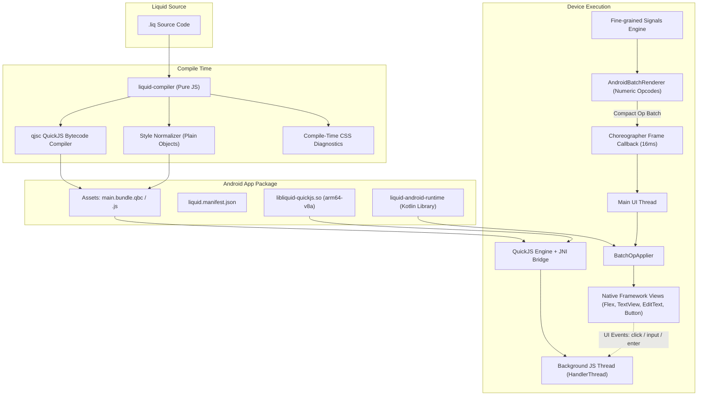

# Liquid Android Target: Native Views + QuickJS + Gradle

The Liquid Android target allows the **exact same `.liq` source code** to execute on the web and on Android. Unlike hybrid webview shells (Cordova, Capacitor) or canvas painters (Flutter), Liquid renders with **real native Android OS framework views** (`android.view` and `android.widget`) powered by an ultra-lightweight **QuickJS** JavaScript runtime.

---

## 1. Architecture Overview



---

## 2. Primitive Element Mapping

Liquid defines a universal cross-platform primitive set. Traditional HTML tags also automatically alias to the appropriate native primitive, guaranteeing zero-change source code compatibility.

| Liquid Primitive | HTML Aliases | Web Render Target | Android Native Class | Description |
|------------------|--------------|-------------------|----------------------|-------------|
| `<view>` | `div`, `section`, `header`, `footer`, `main`, `nav`, `article`, `ul`, `li` | `<div>` / block element | `com.liquid.runtime.LiquidFlexLayout` | Custom ViewGroup with pure Kotlin Flexbox engine (defaults to `FlexDirection.COLUMN`) |
| `<text>` | `span`, `p`, `h1`-`h6`, `label`, `b`, `strong`, `i`, `em`, `small` | `<span>` / tag | `com.liquid.runtime.LiquidTextView` | Text display with typography, strikethrough, underline, and custom font styling |
| `<image>` | `img` | `` | `com.liquid.runtime.LiquidImageView` | Image loading from APK assets, local files, or HTTP URLs |
| `<input>` | `input`, `textarea` | `<input>` | `com.liquid.runtime.LiquidEditText` | Clean text input without native underline; supports rounded borders, focus rings, and placeholder |
| `<button>` | `button` | `<button>` | `com.liquid.runtime.LiquidButton` | Native clickable button stripped of Android gray defaults; supports rounded background, ripple feedback, and `:hover`/`:active` pressed states |
| `<scroll>` | `scroll`, `div.scroll` | `<div style="overflow:auto">` | `com.liquid.runtime.LiquidScrollView` | Vertical scrollable view wrapping an internal Flex container |

---

## 3. CSS Property & Selector Audit Table

Below is the complete audit of CSS properties and selectors supported across Web and Android targets:

| CSS Property / Selector | Web Support | Android Support | Status | Android Implementation Details |
|-------------------------|-------------|-----------------|--------|--------------------------------|
| `display: flex` | Full | Full | **Supported** | Maps to `LiquidFlexLayout` with `FlexDirection.ROW` (or specified direction). |
| `display: block` / none | Full | Full | **Supported** | `block` maps to `FlexDirection.COLUMN`; `none` maps to `View.GONE`. |
| `flex-direction` | Full | Full | **Supported** | `row`, `column`, `row-reverse`, `column-reverse`. |
| `flex-wrap` | Full | Full | **Supported** | `nowrap`, `wrap`. |
| `justify-content` | Full | Full | **Supported** | `flex-start`, `center`, `flex-end`, `space-between`, `space-around`, `space-evenly`. |
| `align-items` | Full | Full | **Supported** | `stretch` (default cross-axis expansion), `flex-start`, `center`, `flex-end`. |
| `align-self` | Full | Full | **Supported** | `auto`, `stretch`, `flex-start`, `center`, `flex-end`. |
| `gap` / `row-gap` / `column-gap` | Full | Full | **Supported** | Pixel / DP inter-item spacing in `LiquidFlexLayout`. |
| `flex` / `flex-grow` / `flex-shrink` | Full | Full | **Supported** | Proportionally expands / shrinks flex child views in `LiquidFlexLayout.LayoutParams`. |
| `width` / `height` | Full | Full | **Supported** | `dp`, `px`, `%` (`100%` -> `MATCH_PARENT`), or `WRAP_CONTENT`. |
| `min-width` / `max-width` | Full | Full | **Supported** | Respects min/max bounds during `onMeasure`. |
| `min-height` / `max-height` | Full | Full | **Supported** | Respects min/max bounds during `onMeasure`. |
| `padding` (all shorthands) | Full | Full | **Supported** | `view.setPadding(left, top, right, bottom)`. Converts `rem`/`em` (1rem = 16px). |
| `margin` (all shorthands) | Full | Full | **Supported** | `MarginLayoutParams`. `margin: auto` maps to `alignSelf: center`. |
| `margin: ... auto` | Full | Approximated | **Approximated** | Horizontal centering via `AlignSelf.CENTER` on flex cross-axis. |
| `position: absolute` / `relative` | Full | Full | **Supported** | Absolute positioning with `top`, `right`, `bottom`, `left`. |
| `background-color` / `background` | Full | Full | **Supported** | Hex, rgb, rgba, and named colors parsed to Android ARGB integer colors. |
| `border-radius` | Full | Full | **Supported** | Rounded corners on `View`, `Button`, `EditText`, `TextView` with outline clipping (`clipToOutline = true`). |
| `border` / `border-width` / `color` | Full | Full | **Supported** | Unified borders rendered via `GradientDrawable` or canvas stroke. |
| `border-bottom` (dividers) | Full | Full | **Supported** | Canvas bottom line drawn at `height - halfStroke` in `LiquidFlexLayout`. |
| `border-top` / `left` / `right` | Full | Full | **Supported** | Per-side border divider lines drawn in `LiquidFlexLayout`. |
| `box-shadow` | Full | Approximated | **Approximated** | Approximated via Android native Material `elevation` and `outlineProvider = ViewOutlineProvider.BACKGROUND`. |
| `opacity` | Full | Full | **Supported** | `View.alpha` (0.0 to 1.0). |
| `overflow: hidden` | Full | Full | **Supported** | `clipToOutline = true` and `canvas.clipPath(roundRect)`. |
| `color` | Full | Full | **Supported** | `TextView.setTextColor`. Inherited by text primitives. |
| `font-size` | Full | Full | **Supported** | `TextView.setTextSize(SP, size)`. Converts `rem`/`em` (1rem = 16px). |
| `font-weight` | Full | Full | **Supported** | Numeric (>=600) or `'bold'` -> `Typeface.BOLD`. |
| `font-family` | Full | Approximated | **Approximated** | Mapped to native Android platform fonts (`sans-serif`, `serif`, `monospace`). |
| `text-align` | Full | Full | **Supported** | `Gravity.START`, `Gravity.CENTER_HORIZONTAL`, `Gravity.END`. |
| `line-height` | Full | Full | **Supported** | `TextView.setLineSpacing(lineHeight - fontHeight, 1.0f)`. |
| `letter-spacing` | Full | Full | **Supported** | `TextView.setLetterSpacing(ls / textSize)`. |
| `text-decoration: line-through` | Full | Full | **Supported** | `Paint.STRIKE_THRU_TEXT_FLAG` applied reactively on completed todo items. |
| `text-decoration: underline` | Full | Full | **Supported** | `Paint.UNDERLINE_TEXT_FLAG`. |
| `text-overflow: ellipsis` | Full | Full | **Supported** | `TextUtils.TruncateAt.END` with `maxLines = 1`. |
| `:hover` / `:active` (pressed state) | Full | Approximated | **Approximated** | Mapped to touch pressed feedback via `StateListDrawable` and `RippleDrawable`. |
| `:focus` (inputs) | Full | Full | **Supported** | Input focus ring highlight (border color transition on `state_focused`). |
| `placeholder` & placeholder color | Full | Full | **Supported** | `EditText.hint` with `#94a3b8` hint text color. |
| `cursor: pointer` | Full | Unsupported | **Unsupported** | Touchscreens do not have hovering mouse cursors (diagnostic emitted, safe no-op). |
| `list-style: none` | Full | Unsupported | **Unsupported** | Native Android views do not render HTML bullet lists (diagnostic emitted, safe no-op). |

---

## 4. Visual Parity & Styling Enhancements

### 1. Unified Shared Template
Both `liquid build` (web) and `liquid build android` compile the exact same `.liq` project structure:
- `src/components/Header.liq`: Dark header banner (`#0f172a`), logo, slot badge (`Ready to build`).
- `src/App.liq`: Max-width container (`600px`), centered (`margin: 2rem auto`), Counter card with double count, and Todo list with reactive items, strikethrough, and bottom row dividers.

### 2. Button Styling Parity (`LiquidButton`)
- Android's default gray button background, 48dp minimum height, and `StateListAnimator` are stripped (`defStyleAttr = 0`, `stateListAnimator = null`).
- Buttons render with custom background color (`#0284c7`), rounded corners (`border-radius: 6px`), white bold text, and a native `RippleDrawable` for pressed visual feedback (`:hover` / `:active` -> `#0369a1`).

### 3. Input Parity (`LiquidEditText`)
- Native underline drawable removed.
- Renders rounded rectangle with border (`1px solid #cbd5e1`, `border-radius: 6px`), padding, and focus ring highlight (`#0284c7`).
- Captures Enter key on software keyboard (`@keydown.enter`) and dispatches submit event to JS.

### 4. Card Shadows & Elevation
- Cards have white background (`#ffffff`), `border-radius: 12px`, padding, and native hardware-accelerated drop shadows via `elevation` (`4dp`) and `outlineProvider`.

### 5. Strikethrough & Todo Toggle
- Toggling a todo item dynamically applies `text-decoration: line-through` and text color `#94a3b8` via reactive `bindStyle` and `Paint.STRIKE_THRU_TEXT_FLAG`.

---

## 5. Compile-Time Diagnostics

When compiling for Android, `liquid-compiler` checks every CSS declaration and produces structured compile-time diagnostics with file path, line number, status, and description:

```
  • Android CSS Diagnostics:
    src/App.liq:30 [approximated] 'font-family' is mapped to system native typeface.
    src/App.liq:36 [approximated] 'margin: auto' approximated via alignSelf: center
    src/App.liq:41 [approximated] 'box-shadow' is approximated using native elevation (4dp) and outline shadow.
    src/App.liq:53 [unsupported] 'cursor: pointer' has no effect on Android touchscreens (ignored).
    src/App.liq:76 [unsupported] 'list-style: none' is unsupported; Android views have no default bullet lists (ignored).
    Summary: 5 diagnostics (2 unsupported, 3 approximated)
```

Diagnostics are accessible programmatically via `compile(source, { target: 'android' }).diagnostics`.

---

## 6. Known Visual Differences & Parity Verification

While layout dimensions, padding, colors, radii, dividers, and typography match web rendering closely, certain web-specific visual features have platform-specific representations:

1. **Drop Shadows**:
   - *Web*: Supports arbitrary multi-layer box shadows with X/Y offsets, blur radius, spread radius, and colored ambient glow (`box-shadow: 0 4px 6px -1px rgb(0 0 0 / 0.1)`).
   - *Android*: Approximated using native Android Material `elevation` (directional light caster + ambient shadow). Elevation shadows follow the View outline but cannot customize spread radius or arbitrary shadow colors independently.
2. **Font Rendering**:
   - *Web*: Uses system font stacks like `-apple-system, BlinkMacSystemFont, "Segoe UI", Roboto`.
   - *Android*: Uses the device's native Roboto / system Typeface (`Typeface.SANS_SERIF`).
3. **Cursor & Hover**:
   - *Web*: Displays pointer cursor on hover and triggers `:hover` styles on mouseover.
   - *Android*: Displays `:hover` / `:active` color changes and ripple feedback upon touch press.

### Verification Procedure:
1. **Web Build**:
   ```bash
   cd examples/android-sample
   npm run build
   # View at http://localhost:4173
   ```
2. **Android Build**:
   ```bash
   cd examples/android-sample
   liquid build android --release
   # APK output: /sdcard/liquid.apk (1.16 MB)
   ```
3. **On-Device Self-Test**:
   - When the APK launches, `LiquidActivity` runs an automated on-device interaction test:
     - Detects the `+` button and counter text.
     - Simulates an on-device tap on `+`.
     - Verifies counter changes from `0` to `1`.
     - Writes verification logs to `/sdcard/liquid_launch.log`.
